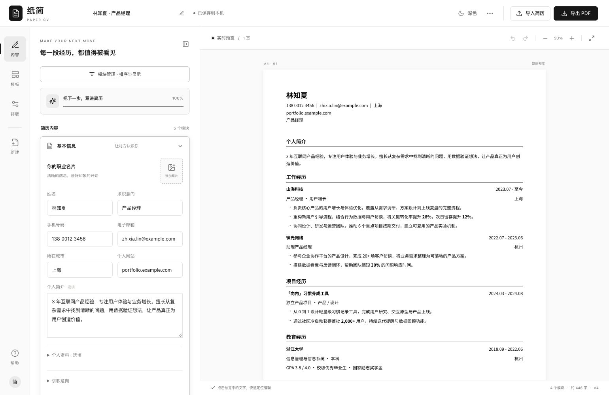

# 纸简 PaperCV

### 让每一段经历，都值得被看见。

一个专注内容与排版的在线简历编辑网站。 
整理经历，选择模板，实时预览，导出属于你的简历。

  

[功能亮点](#功能亮点) · [模板风格](#模板风格) · [开始制作](#开始制作)

 

## 功能亮点

|     | 功能               | 你可以做什么                                                     |
| :-: | :----------------- | :--------------------------------------------------------------- |
| ✍️  | **自由编辑**       | 填写个人信息、教育、工作、项目与技能，按需添加、排序或隐藏模块。 |
| 🎨  | **灵活排版**       | 调整字体、颜色、间距和纸张尺寸，让简历呈现自己的风格。           |
| 👀  | **实时预览**       | 边编辑边查看简历效果与分页，让内容与布局恰到好处。               |
| 📄  | **PDF 导入与导出** | 导入文字 PDF 辅助整理内容，通过浏览器打印保存为 PDF。            |
| 💾  | **保存与备份**     | 自动保存编辑内容，支持撤销、重做，以及 JSON 备份与恢复。         |
| 🌗  | **深浅色主题**     | 随时切换编辑界面，选择适合自己的阅读与创作体验。                 |

## 模板风格

六套模板，为不同的经历找到合适的表达。

| 模板           | 风格                                 |
| :------------- | :----------------------------------- |
| **经典专业**   | 居中页眉，清晰分区，简洁稳重。       |
| **简约现代**   | 左右分列，简洁色块，重点突出。       |
| **人文书写**   | 衬线字体，编号章节，舒展耐读。       |
| **双栏简约**   | 双栏布局，信息分明，层次清晰。       |
| **时间轴履历** | 时间轨迹串联经历，成长脉络一目了然。 |
| **高效紧凑**   | 紧凑排版，高效表达，充分利用每一页。 |

## 开始制作

**填写经历 → 选择模板 → 调整排版 → 导出 PDF**

> 编辑内容保存在当前浏览器中。建议定期导出 **JSON 备份**，方便后续恢复编辑；使用 **PDF** 投递和分享。

---

**纸简 · 专注内容，从容呈现。**

[参与贡献](CONTRIBUTING.md) · [MIT License](LICENSE) · 自由使用、修改与分发

